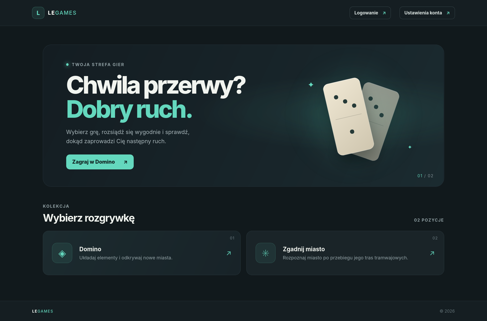
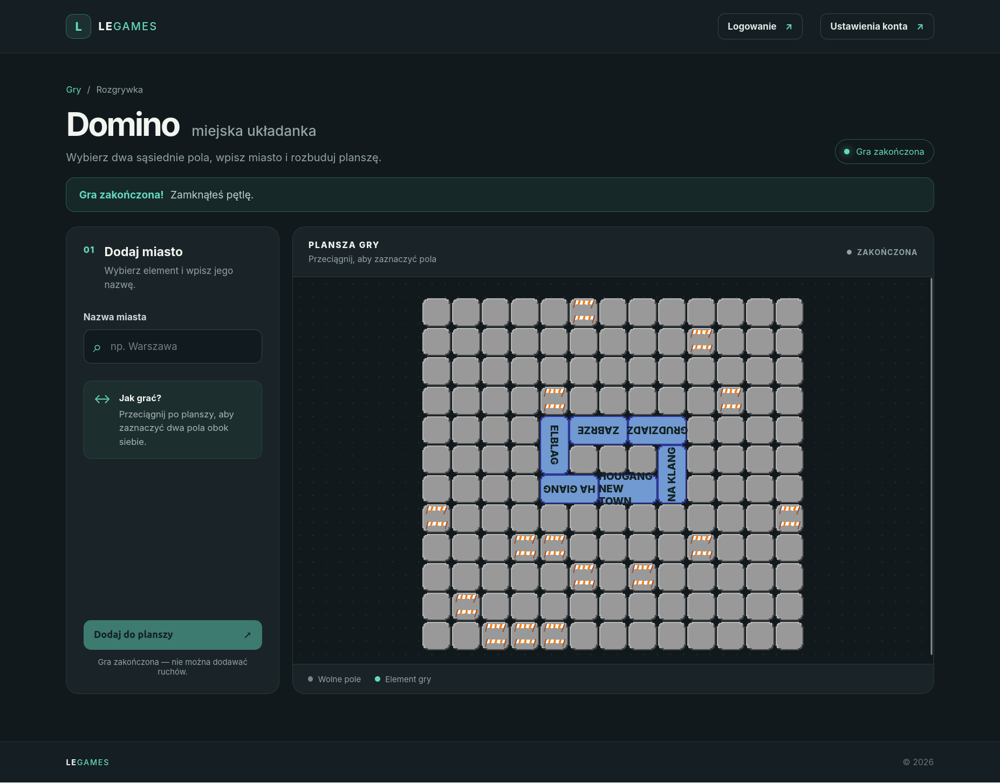
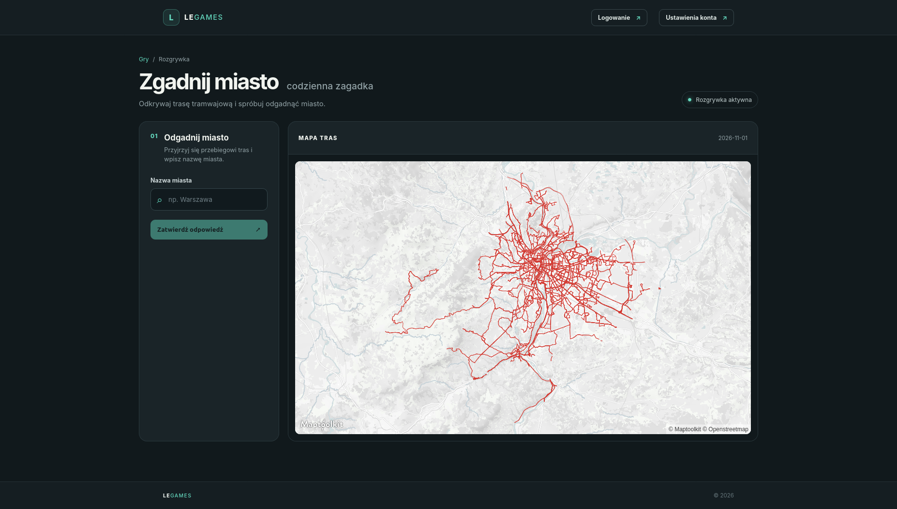

# Le Games App

Przeglądarkowa aplikacja z krótkimi grami opartymi na miastach. Projekt składa
się z frontendu Angular i backendu Spring Boot; dane rozgrywek są przechowywane
w PostgreSQL.

## Gry

- **Domino** — zaznacz dwa sąsiednie pola, wybierz miasto i rozbudowuj planszę,
  aż zamkniesz pętlę.
- **Zgadnij miasto** — rozpoznaj miasto na podstawie przebiegu jego tras
  tramwajowych. Po każdej błędnej odpowiedzi zobaczysz odległość od celu.

Gra Domino i codzienna zagadka zapisują postęp gracza. Możesz zacząć jako gość,
a następnie połączyć postęp z kontem. Identyfikator UID gościa działa jak dane
dostępowe — zachowaj go prywatnie.

## Zrzuty ekranu







## Technologie

- **Frontend:** Angular 21, TypeScript, MapLibre GL
- **Backend:** Java 21, Spring Boot 3, Spring Data JPA, Spring Security
- **Baza danych:** PostgreSQL
- **Testy:** Vitest (frontend), JUnit i Spring Boot Test (backend)

## Uruchomienie lokalne

Wymagane: Java 21, Node.js z npm oraz działająca instancja PostgreSQL.

### 1. Skonfiguruj bazę danych

Backend korzysta z konfiguracji profilu `local` w
`backend/src/main/resources/application-local.properties`. Utwórz bazę
PostgreSQL i ustaw w tym pliku adres bazy oraz dane dostępowe. Nie dodawaj
lokalnych haseł ani sekretów do repozytorium.

### 2. Uruchom backend

W katalogu `backend/`:

```bash
./mvnw spring-boot:run
```

Serwer domyślnie działa pod adresem `http://localhost:8080`. Pliki z danymi
miast są wczytywane z katalogu `backend/data/`, dlatego uruchamiaj aplikację
z katalogu `backend/`.

Interaktywna dokumentacja API (Swagger UI) jest dostępna pod adresem
`http://localhost:8080/swagger-ui/index.html`.

### 3. Uruchom frontend

W osobnym terminalu, w katalogu `frontend/`:

```bash
npm install
npm start
```

Aplikacja będzie dostępna pod `http://localhost:4200`. Domyślny adres API to
`http://localhost:8080/api`; w razie potrzeby zmień go w
`frontend/src/environments/environment.ts`.

## Testy i build

Frontend, z katalogu `frontend/`:

```bash
npm test
npm run build
```

Backend, z katalogu `backend/`:

```bash
./mvnw test
```

## Struktura projektu

```text
backend/   API, logika gier, testy i pliki danych
frontend/  aplikacja Angular
```

## Uwierzytelnianie

Backend udostępnia endpointy rejestracji gościa, logowania i tworzenia konta
pod `/api/auth`. Operacje na grach przypisanych do gracza wymagają tokenu
z nagłówka `Authorization`. Szczegóły endpointów można sprawdzić w Swagger UI.
